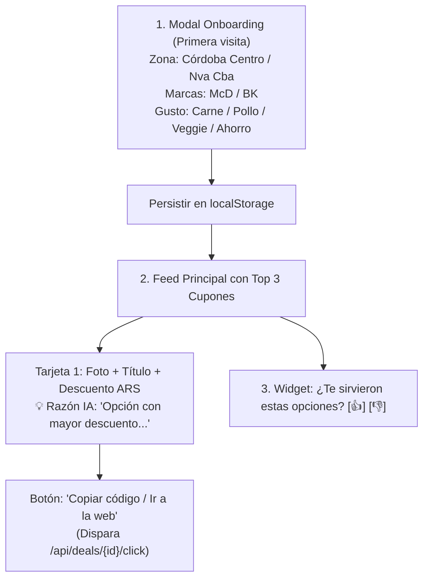

# Especificación Técnica y de Producto - MVP
## Fast Food Deals AI (Córdoba, Argentina)

---

## 1. Contexto de Negocio y Piloto

* **Ubicación Piloto:** Ciudad de Córdoba, Argentina (zonas de alta densidad: Centro / Nueva Córdoba / Centros Comerciales: Patio Olmos, Nuevocentro, Dino Mall).
* **Moneda:** Pesos Argentinos (ARS `$`).
* **Cadenas Piloto:**
  1. **McDonald's Argentina** (`mcdonalds.com.ar` / Web Cuponeo / App AR).
  2. **Burger King Argentina** (`burgerking.com.ar` / Web Promociones / App AR).
* **Propuesta de Valor:** Web app ultraligero que reúne automáticamente los descuentos de comida rápida en Córdoba y utiliza un LLM para recomendar y justificar las **3 mejores opciones personalizadas** para el usuario según sus gustos y presupuesto.

---

## 2. Hipótesis a Validar y KPIs

* **Hipótesis:** *"Los usuarios de Córdoba prefieren consultar un recomendador inteligente con 3 ofertas curadas de McDonald's y Burger King en vez de abrir ambas apps, y hacen clic para canjearlas."*
* **KPI Primario:** Tasa de clics en "Copiar código / Ir a la app" $\ge 20\%$ sobre sesiones activas.
* **KPI Secundario:** Feedback positivo $\ge 70\%$ en el widget de 1 clic (👍).
* **KPI Técnico:** Scraper operando de forma autónoma durante 7 días consecutivos sin fallos no controlados.

---

## 3. Stack Tecnológico Definido

* **Backend:** **.NET 10** (C# - ASP.NET Core Web API).
  * **Scraping / Ingesta:** `HttpClient` (APIs web internas privadas) + `Microsoft.Playwright` para páginas con renderizado dinámico en C#. Orquestado con `IHostedService` / `BackgroundService` periódico (cada 6-12 hs).
  * **Base de Datos / ORM:** **MySQL 8.0+** con Entity Framework Core (`Pomelo.EntityFrameworkCore.MySql`).
  * **Integración IA:** Cliente HTTP / SDK oficial de Google Gemini (ej. modelo `gemini-2.5-flash` o `gemini-1.5-flash`) con salida estructurada en JSON.
* **Frontend:** **React** (Vite + TypeScript + Tailwind CSS).
  * **Gestión de Estado y Persistencia:** `localStorage` para preferencias y zona del usuario (sin auth obligatoria).
  * **Íconos e Interfaz:** `lucide-react`, diseño optimizado para móvil (*mobile-first*).

---

## 4. Estructura de Directorios del Repositorio

```text
fastfood-deals/
├── backend/
│   ├── FastFoodDeals.sln
│   └── src/
│       ├── FastFoodDeals.Api/              # Controladores, Program.cs, Middleware
│       │   ├── Controllers/                # DealsController, RecommendationsController, FeedbackController
│       │   └── appsettings.json
│       ├── FastFoodDeals.Core/             # Entidades de dominio, Interfaces, DTOs
│       │   ├── Entities/                   # Deal.cs, FeedbackEvent.cs
│       │   ├── DTOs/                       # UserPreferencesDto.cs, RecommendationResponseDto.cs
│       │   └── Interfaces/                 # IScraperService.cs, IAiRecommenderService.cs, IDealRepository.cs
│       └── FastFoodDeals.Infrastructure/  # EF Core, Scrapers en C#, Cliente Gemini
│           ├── Data/                       # AppDbContext.cs, Migrations
│           ├── Scrapers/                   # McDonaldsScraper.cs, BurgerKingScraper.cs, ScraperBackgroundWorker.cs
│           └── Services/                   # GeminiRecommenderService.cs
├── frontend/
│   ├── package.json
│   ├── tsconfig.json
│   ├── vite.config.ts
│   └── src/
│       ├── components/                     # OnboardingModal.tsx, DealCard.tsx, FeedbackWidget.tsx
│       ├── services/                       # api.ts (cliente Axios/Fetch hacia .NET)
│       ├── types/                          # deal.ts, preferences.ts
│       ├── App.tsx
│       └── main.tsx
└── MVP.md                                  # Este documento de especificación
```

---

## 5. Esquema de Datos y Modelos (.NET / C#)

### Entidad Principal: `Deal`
```csharp
public class Deal
{
    public Guid Id { get; set; } = Guid.NewGuid();
    public string ExternalId { get; set; } = string.Empty; // ID de origen del cupón
    public string Brand { get; set; } = string.Empty;      // "McDonald's" | "Burger King"
    public string Title { get; set; } = string.Empty;
    public string Description { get; set; } = string.Empty;
    [Column(TypeName = "decimal(10,2)")]
    public decimal OriginalPrice { get; set; }             // Moneda: ARS

    [Column(TypeName = "decimal(10,2)")]
    public decimal DiscountPrice { get; set; }             // Moneda: ARS
    public double DiscountPercentage { get; set; }         // Calculado
    public string Category { get; set; } = "general";      // "burger_beef", "chicken", "veggie", "dessert", "cafe"
    public string? CouponCode { get; set; }
    public string RedemptionUrl { get; set; } = string.Empty;
    public string ImageUrl { get; set; } = string.Empty;
    public string LocationZone { get; set; } = "cordoba_all";
    public DateTime? ExpiresAt { get; set; }
    public DateTime LastScrapedAt { get; set; } = DateTime.UtcNow;
    public bool IsActive { get; set; } = true;
}
```

---

## 6. Contrato de la API (.NET Endpoints)

| Método | Endpoint | Descripción | Body / Query | Respuesta |
| :--- | :--- | :--- | :--- | :--- |
| `GET` | `/api/deals` | Lista cupones activos (con filtros opcionales) | `?brand=mcdonalds&category=burger_beef` | `List<DealDto>` |
| `POST` | `/api/recommendations` | Devuelve el **Top 3** curado por IA con justificación | `UserPreferencesDto` | `RecommendationResponseDto` |
| `POST` | `/api/deals/{id}/click` | Telemetría: registra clic de canje para medición | URL param: `id` | `204 No Content` |
| `POST` | `/api/feedback` | Registra calificación de 1 clic (👍 / 👎) | `{ dealId?, isPositive: bool, comment? }` | `204 No Content` |
| `POST` | `/api/scraper/trigger` | Endpoint de desarrollo para forzar corrida del scraper | N/A (Header secreto de Admin) | `{ status: "started" }` |

### DTOs de Recomendación
```csharp
public record UserPreferencesDto(
    string Zone,                    // ej: "cordoba_centro"
    List<string> PreferredBrands,   // ej: ["McDonald's", "Burger King"]
    string PrimaryPreference,       // ej: "burger_beef" | "chicken" | "veggie" | "max_saving"
    decimal? MaxBudget              // Opcional en ARS
);

public record RecommendedDealItemDto(
    DealDto Deal,
    string AiReasoning              // Frase explicativa generada por el LLM
);

public record RecommendationResponseDto(
    List<RecommendedDealItemDto> Recommendations,
    DateTime GeneratedAt
);
```

---

## 7. Estrategia de Ingesta y Scraping (Córdoba, AR)

1. **Vía Primaria (APIs Web Internas):**
   * Inspección de tráfico web de los sitios oficiales de pedidos/cupones para Argentina:
     * McDonald's Argentina: endpoints de cupones web o catálogo de delivery web.
     * Burger King Argentina: catálogo de promociones web.
   * `HttpClient` en C# enviando cabeceras reales de navegador (`User-Agent`, `Referer`, cookies de sesión si aplica).
2. **Vía Secundaria (`Microsoft.Playwright` en C#):**
   * En caso de requerir autenticación básica de navegador o renderizado SPA dinámico, un worker en C# corre Playwright headless para extraer elementos del DOM.
3. **Manejo de Errores e Idempotencia:**
   * El scraper usa `ExternalId` o `Title + Brand` para no duplicar cupones en la base de datos (`Upsert`).
   * Los cupones que ya no aparezcan en la web se marcan como `IsActive = false`.

---

## 8. Prompt del Motor de Recomendación (Gemini API)

El servicio `GeminiRecommenderService.cs` enviará un prompt con el catálogo y las preferencias del usuario exigiendo un **JSON Schema estricto**:

```text
Eres un asistente experto en comida rápida y ahorro para la ciudad de Córdoba, Argentina.
Analiza la siguiente lista de cupones disponibles (con precios en ARS) y el perfil del usuario.
Selecciona EXACTAMENTE los 3 mejores cupones que mejor coincidan con sus gustos y maximicen su ahorro.

Para cada cupón seleccionado, genera una frase corta (máximo 25 palabras) en tono cercano y persuasivo explicando por qué se lo recomiendas (menciona el % de ahorro o la relación precio/calidad).

Responde exclusivamente con el siguiente formato JSON:
{
  "recommendations": [
    {
      "dealId": "guid-del-cupon",
      "reasoning": "Por qué se recomienda este cupón"
    }
  ]
}
```

---

## 9. Interfaz de Usuario (React + Tailwind CSS)



---

## 10. Delimitación Estricta: Fuera de Alcance (Out of Scope)

* ❌ **Sin cuentas ni login de usuarios:** No hay tablas de usuarios ni contraseñas. Todo perfil vive en `localStorage`.
* ❌ **Sin pasarela de pagos:** No se procesan transacciones de dinero; la compra final se hace en la app o caja de la cadena.
* ❌ **Sin apps móviles nativas:** Únicamente Web App responsive optimizada para pantallas móviles.
* ❌ **Sin bots conversacionales largos:** Solo tarjetas con la justificación directa de la IA para minimizar latencia y consumo de tokens.
